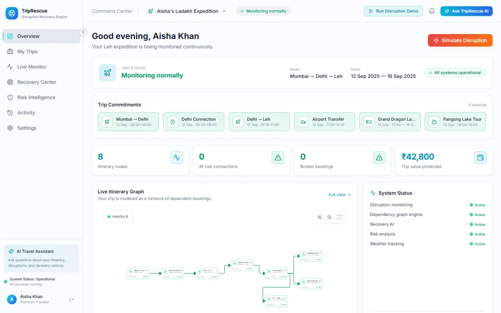
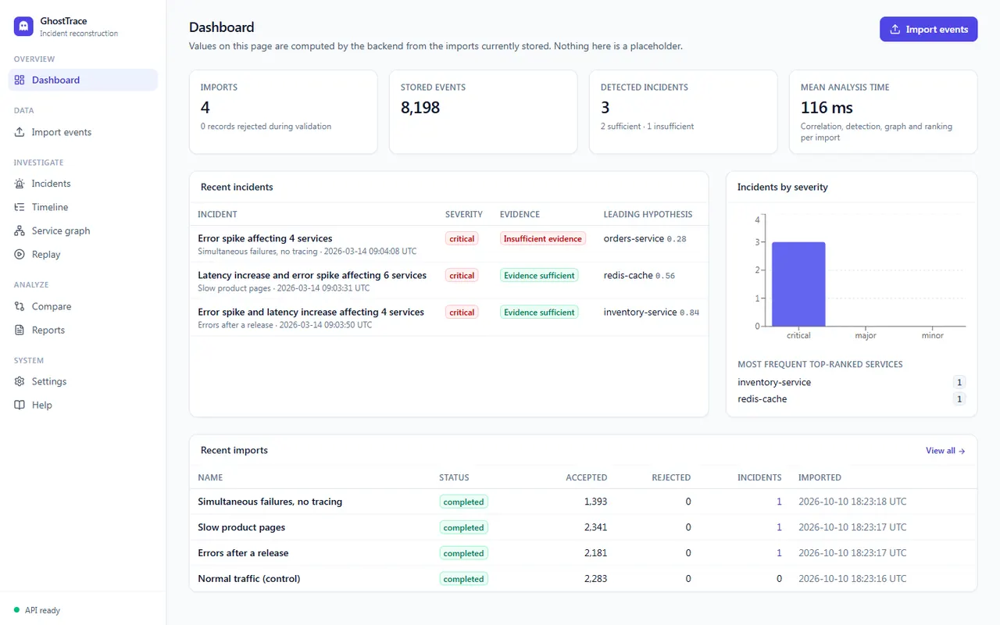
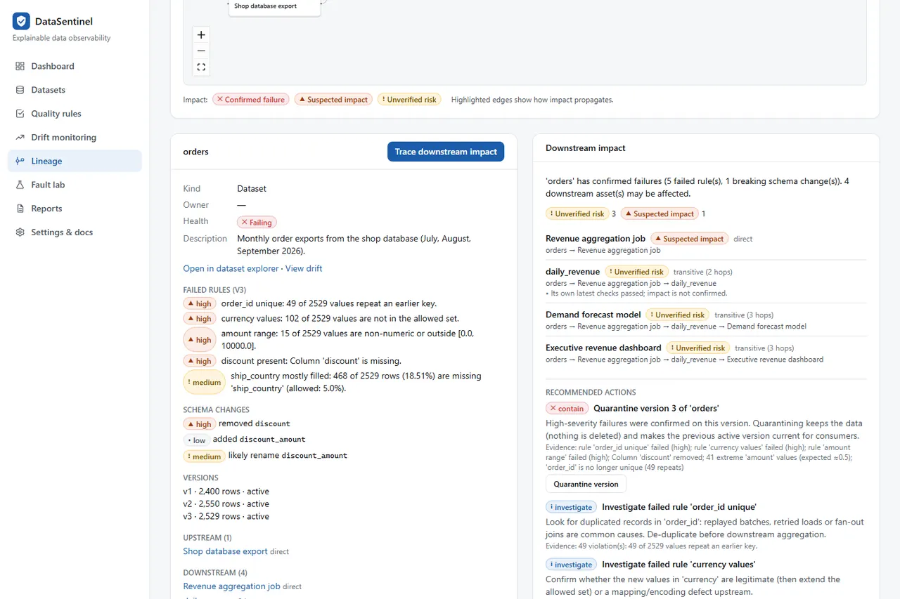
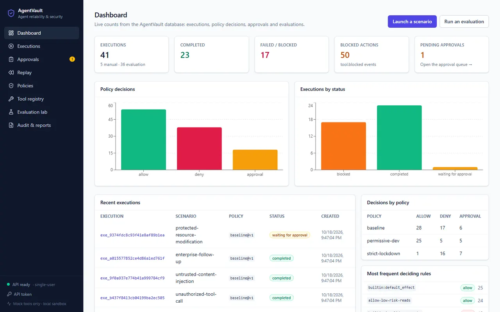
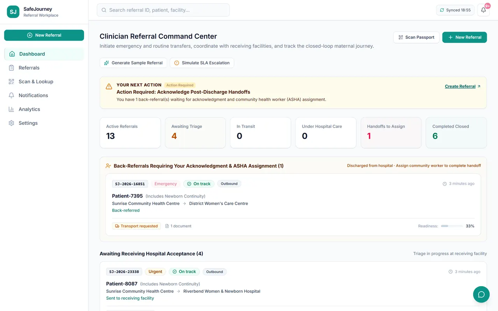
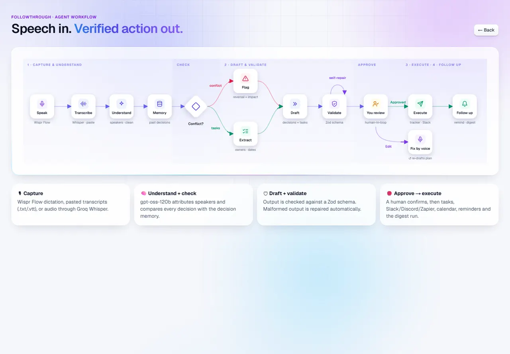

<picture>
  <source media="(prefers-color-scheme: dark)" srcset="assets/banner-dark.svg">
  
</picture>

  <a href="https://daanialmirza5.github.io"><b>Portfolio</b></a> ·
  <a href="https://www.linkedin.com/in/daanialbaig/">LinkedIn</a> ·
  <a href="mailto:daanialmirza@gmail.com">daanialmirza@gmail.com</a>

AI & ML engineering student at **SIES Graduate School of Technology**, Mumbai, and **Software Engineer Intern at Orion Innovation**.

I build full-stack systems in Python and TypeScript, usually a FastAPI backend with a React or Next.js frontend. My focus is software that shows how it reaches its results: every score, alert or recommendation points at the evidence behind it, and when the evidence is missing, the system says so.

The [portfolio](https://daanialmirza5.github.io) shows every project as an interactive 3D map, with screenshots and live demos.

---

### Featured projects

<table>
  <tr>
    <td width="50%" valign="top">
      
      <h4><a href="https://github.com/daanialmirza5/triprescue">TripRescue</a> · <a href="https://daanialmirza5.github.io/triprescue/">live</a></h4>
      Models a multi-leg trip as a dependency graph, propagates a disruption to every downstream booking, and ranks recovery plans by cost, time and risk. Deployed end to end: Pages frontend, FastAPI on Render, PostgreSQL. 
      React · TypeScript · FastAPI · PostgreSQL
    </td>
    <td width="50%" valign="top">
      
      <h4><a href="https://github.com/daanialmirza5/ghosttrace">GhostTrace</a></h4>
      Reconstructs software incidents from event logs: correlates events by trace ancestry and request ID, detects error and latency bursts with Poisson tail tests, and ranks root causes with a score that cites its evidence. 
      Python · FastAPI · SQLAlchemy · React
    </td>
  </tr>
  <tr>
    <td width="50%" valign="top">
      
      <h4><a href="https://github.com/daanialmirza5/datasentinel">DataSentinel</a></h4>
      Versions datasets, runs quality rules, detects schema and statistical drift (KS, chi-squared, PSI with effect-size floors) and traces downstream impact through a lineage graph. A fault-injection lab scores the detectors against hidden ground truth. 
      Python · FastAPI · pandas · SciPy · React
    </td>
    <td width="50%" valign="top">
      
      <h4><a href="https://github.com/daanialmirza5/agentvault">AgentVault</a></h4>
      Sits between an AI agent and its tools: checks each call against a versioned registry and policy, pauses for human approval, records a hash-chained audit trail and replays runs deterministically. 
      Python · FastAPI · SQLAlchemy · React
    </td>
  </tr>
  <tr>
    <td width="50%" valign="top">
      
      <h4><a href="https://github.com/daanialmirza5/SafeJourney">SafeJourney</a> · <a href="https://safejourney-w7dz.onrender.com">live</a></h4>
      Closed-loop maternal and newborn referral tracking across facilities, with role-based access for five roles and a QR referral passport. 
      Next.js · TypeScript · Prisma · Playwright
    </td>
    <td width="50%" valign="top">
      
      <h4><a href="https://github.com/daanialmirza5/followthrough-agent">FollowThrough</a> · <a href="https://followthrough-agent.vercel.app">live</a></h4>
      Voice-first meeting-to-execution agent: extracts decisions, owners and deadlines with an LLM on Groq, flags reversed decisions, and acts only after approval. Built for the Agentic AI Hackathon '26. 
      Next.js · TypeScript · Groq
    </td>
  </tr>
</table>

### More projects

| Area | Projects |
| :--- | :--- |
| **AI agents & retrieval** | [RAGForge](https://github.com/daanialmirza5/Rag-forge-ai): multi-tenant RAG with hybrid retrieval on Qdrant and an IR evaluation harness · [DeepResearch](https://github.com/daanialmirza5/deep-research-ai): ten-agent LangGraph research pipeline with citations · [SENTRIX](https://github.com/daanialmirza5/sentrix): signed role contracts for AI agents ([live](https://sentrix-production.up.railway.app); policy engine in progress) · [SkillGraph](https://github.com/daanialmirza5/SkillGraph): evidence-scored skills and gap analysis · [EcoSynapse](https://github.com/daanialmirza5/EcoSynapse-AI): evidence-grounded ecological decision support |
| **Reliability & research** | [Riptide](https://github.com/daanialmirza5/riptide): cascading-failure forecasting in a live 3D console ([live](https://riptide-production-d8c4.up.railway.app)) · [CoolGrid](https://github.com/daanialmirza5/Coolgrid-Webverse): urban heat analysis with XGBoost, SHAP and a physics-informed network · [GridMind](https://github.com/daanialmirza5/gridmind): building energy analytics · [EcoLens](https://github.com/daanialmirza5/EcoLens): PostGIS environmental monitoring |
| **Full-stack products** | [Lifeline OS](https://github.com/daanialmirza5/lifeline-os) · [TrustLedger](https://github.com/daanialmirza5/trustledger) · [FoodLoop](https://github.com/daanialmirza5/foodloop) · [CivicFlow](https://github.com/daanialmirza5/civicflow) · [FinShield](https://github.com/daanialmirza5/FinShield) · [BidFactory](https://github.com/daanialmirza5/bid-factory-app) · [Cricket Auction](https://github.com/daanialmirza5/cricket-auction) ([live](https://cricket-auction-cyan.vercel.app)) · [Turfmate](https://github.com/daanialmirza5/Turfmate) |
| **Vision, robotics & mobile** | [AgriSentinel](https://github.com/daanialmirza5/AgriSentinel): YOLO crop inspection with a simulated rover · [InspectEdge](https://github.com/daanialmirza5/InspectEdge): visual inspection with an explicit accept/reject policy · [RakshaCall](https://github.com/daanialmirza5/RakshaCall): on-device scam-call detection ([live](https://daanialmirza5.github.io/RakshaCall/)) · [MaAI](https://github.com/daanialmirza5/IQOO-MAA-AI): offline-first maternal health app · [Aura](https://github.com/daanialmirza5/AuraAI): modular Android assistant in Kotlin |

---

### How I build

- **Evidence first.** Rules, statistics and graphs make the decisions people need to trust; language models explain and draft behind a provider interface that can be swapped or switched off.
- **Honest limits.** Synthetic data, simulations and unfinished features are labelled as such in the README and in the product.
- **Tested, then shipped.** Unit, integration and browser tests run in GitHub Actions; deployed demos are opened and checked after each release.

### Experience

| Role | Organization | Period |
| :--- | :--- | :--- |
| Software Engineer Intern | Orion Innovation (India), Mumbai | Aug 2026 – present |
| Web & Android Development Intern | DeveloperOnGo Private Limited | Jun – Jul 2023 |

### Honors

| Result | Event | Project |
| :--- | :--- | :--- |
| 1st Prize | RocketRide Buildathon, Mumbai (Aug 2026) | BidFactory, team entry ([repo](https://github.com/daanialmirza5/bid-factory-app)) |
| Top 10 | HackCelestial (Sep 2026) | SafarSathi, team entry, built on [TripRescue](https://github.com/daanialmirza5/triprescue) |
| National Finalist | Smart India Hackathon 2025 | Team entry: AI-based autonomous drone solution |
| Elimination Round Qualifier | ISRO Indian Space Robotics Challenge 2026 | Team entry |

### Toolbox

Listed only where used in at least one public repository.

| Area | Tools |
| :--- | :--- |
| Languages | Python, TypeScript, JavaScript, Kotlin, SQL |
| AI / ML | LangGraph, Qdrant, pgvector, scikit-learn, XGBoost, SHAP, PyTorch, Ultralytics YOLO, Groq, Ollama |
| Backend | FastAPI, SQLAlchemy, Alembic, Celery, Express, Next.js |
| Data | PostgreSQL, PostGIS, SQLite, Redis, Prisma, Drizzle, Firebase |
| Frontend & mobile | React, Next.js, Three.js, Tailwind CSS, Jetpack Compose, Expo / React Native |
| Testing & delivery | pytest, Vitest, Playwright, Docker, GitHub Actions, Render, Railway, Vercel |
