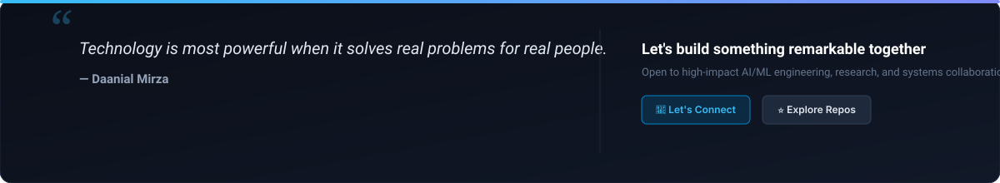

<div align="center">

<a href="https://github.com/daanialmirza5">
  
</a>

</div>

---

### About

```text
Name:       Daanial Mirza (@daanialmirza5)
Current:    Software Engineering Intern @ Orion Innovation (India)
Education:  Final-year AI & ML student @ SIES Graduate School of Technology (SIES GST)
Interests:  RAG and agent systems · Computer vision · Full-stack web and Android apps
Location:   Mumbai, India
```

I build full-stack applications with Python and TypeScript, with a focus on retrieval-augmented generation, LLM agent pipelines, and decision-support tools that explain how they reach their results. Most of my projects pair a FastAPI backend with a React or Next.js frontend and include automated tests.

---

### Experience

| Role | Organization | Period | Work |
| :--- | :--- | :--- | :--- |
| **Software Engineer Intern** | **Orion Innovation (India)**, Mumbai | Aug 2026 – present | Three-month internship. |
| **Web & Android Development Intern** | **DeveloperOnGo Private Limited** | Jun – Jul 2023 | Six-week internship: built responsive web pages, assisted with Android app development in Java / Android Studio, and integrated REST APIs. |

---

### Honors

| Result | Event | Project |
| :--- | :--- | :--- |
| **1st Prize** | RocketRide Buildathon, Mumbai (Aug 2026) | [BidFactory](https://github.com/daanialmirza5/bid-factory-app): AI-assisted tender and RFP analysis |
| **Top 10** | HackCelestial (Sep 26–27, 2026) | SafarSathi, built as [TripRescue](https://github.com/daanialmirza5/triprescue): travel disruption recovery |
| **National Finalist** | Smart India Hackathon 2025 | Team project: AI-based autonomous drone solution |
| **Elimination Round Qualifier** | ISRO Indian Space Robotics Challenge (2026) | Team entry |

---

### Skills

Listed only where the technology is used in at least one public repository.

| Area | Tools |
| :--- | :--- |
| **Languages** | `Python` · `TypeScript` · `JavaScript` · `Kotlin` · `SQL` |
| **AI / ML** | `LangGraph` · `Qdrant` · `pgvector` · `scikit-learn` · `XGBoost` · `SHAP` · `PyTorch` · `OpenCV` · `Ultralytics YOLO` · `Groq` · `Ollama` |
| **Backend** | `FastAPI` · `Node.js` · `Express` · `Next.js (App Router)` · `Celery` · `WebSockets` |
| **Data** | `PostgreSQL` · `PostGIS` · `Prisma` · `Drizzle` · `SQLite` · `Redis` · `Firebase` |
| **Frontend & mobile** | `React` · `Next.js` · `Tailwind CSS` · `Jetpack Compose` · `Expo / React Native` |
| **Testing & tooling** | `pytest` · `Vitest` · `Playwright` · `Docker` · `GitHub Actions` · `Git` |

<br/>

<div align="center">
  
</div>

---

### Featured projects

<table>
  <tr>
    <td width="50%" valign="top">
      <h4><a href="https://github.com/daanialmirza5/datasentinel">DataSentinel</a></h4>
      <p><b>Explainable data observability</b></p>
      <p>Imports datasets as immutable versions, profiles them, runs declarative quality rules, detects schema and statistical drift between versions, and traces downstream impact through a declared lineage graph. Includes a seeded fault-injection lab that scores detectors against hidden ground truth.</p>
      <p><code>Python</code> · <code>FastAPI</code> · <code>React</code> · <code>TypeScript</code></p>
    </td>
    <td width="50%" valign="top">
      <h4><a href="https://github.com/daanialmirza5/ghosttrace">GhostTrace</a></h4>
      <p><b>Software incident reconstruction</b></p>
      <p>Normalises JSON/CSV event logs, correlates them through trace ancestry and request IDs, detects error and latency bursts, and ranks root-cause hypotheses with a transparent heuristic score that cites the supporting events.</p>
      <p><code>Python</code> · <code>FastAPI</code> · <code>React</code> · <code>TypeScript</code></p>
    </td>
  </tr>

  <tr>
    <td width="50%" valign="top">
      <h4><a href="https://github.com/daanialmirza5/triprescue">TripRescue</a></h4>
      <p><b>Travel disruption recovery for multi-leg trips</b></p>
      <p>Models an itinerary as a dependency graph, propagates a disruption to downstream legs (traversal, cycle detection, topological ordering), and computes risk, health and refund summaries to rank recovery options.</p>
      <p><code>Python</code> · <code>FastAPI</code> · <code>React</code> · <code>TypeScript</code></p>
    </td>
    <td width="50%" valign="top">
      <h4><a href="https://github.com/daanialmirza5/Rag-forge-ai">RAG Forge AI</a></h4>
      <p><b>Multi-tenant RAG platform</b></p>
      <p>LangGraph pipeline with query rewriting, hybrid dense + sparse retrieval on Qdrant, and optional reranking through the Voyage API. Includes an offline evaluation harness that compares dense, BM25 and RRF-fused retrieval with MRR and NDCG on a built-in benchmark set.</p>
      <p><code>Python</code> · <code>FastAPI</code> · <code>Qdrant</code> · <code>LangGraph</code> · <code>Next.js</code></p>
    </td>
  </tr>

  <tr>
    <td width="50%" valign="top">
      <h4><a href="https://github.com/daanialmirza5/gridmind">GridMind</a></h4>
      <p><b>Building energy analytics (synthetic data)</b></p>
      <p>Demand forecasting, waste and anomaly detection, prioritised recommendations, and a what-if simulator for setpoint, after-hours, lighting and peak-shift changes.</p>
      <p><code>Python</code> · <code>FastAPI</code> · <code>pandas</code> · <code>Next.js</code></p>
    </td>
    <td width="50%" valign="top">
      <h4><a href="https://github.com/daanialmirza5/AuraAI">AuraAI</a></h4>
      <p><b>Android multi-agent assistant</b></p>
      <p>Kotlin / Jetpack Compose app split into 18 Gradle modules (planner, reasoning, memory, tools, plugins), with pluggable cloud and local LLM providers.</p>
      <p><code>Kotlin</code> · <code>Jetpack Compose</code> · <code>Coroutines</code> · <code>Room</code></p>
    </td>
  </tr>
</table>

<p align="right">
  <a href="https://github.com/daanialmirza5?tab=repositories"><b>All repositories ➔</b></a>
</p>

---

### Other projects

<details open>
<summary><b>AI agents and retrieval</b></summary>
<br/>

- **[Deep Research AI](https://github.com/daanialmirza5/deep-research-ai)**: LangGraph pipeline with ten nodes (planner, research, summarizer, fact-checker, writer, reviewer, citation, evaluation, memory and more) that produces cited research reports.
- **[AI Meeting Follow-Up Agent](https://github.com/daanialmirza5/ai-meeting-followup-agent)**: Extracts decisions and action items from transcripts with LLaMA 3 on Groq and exports follow-ups as RFC 5545 iCalendar files.
- **[RakshaCall](https://github.com/daanialmirza5/RakshaCall)**: Client-side web app that flags social-engineering cues in a call transcript captured with browser speech recognition. No backend.

</details>

<details>
<summary><b>Computer vision and edge</b></summary>
<br/>

- **[InspectEdge](https://github.com/daanialmirza5/InspectEdge)**: Visual inspection workflow (FastAPI + React) with a YOLO inference wrapper and a configurable accept/reject policy. It currently ships with the COCO-pretrained `yolov8n` placeholder, not a trained defect model. A training script is included for a labelled defect dataset.
- **[AgriSentinel](https://github.com/daanialmirza5/AgriSentinel)**: Simulated field-inspection rover with a crop-monitoring dashboard.
- **[MaAI (IQOO-MAA-AI)](https://github.com/daanialmirza5/IQOO-MAA-AI)**: Offline-first Expo / React Native app for frontline maternal-health workers, with Tesseract OCR and a colour-ratio pallor heuristic. The heuristic is not a clinically validated model.

</details>

<details>
<summary><b>Environment and geospatial</b></summary>
<br/>

- **[EcoSynapse AI](https://github.com/daanialmirza5/EcoSynapse-AI)**: Ecological decision support that combines a NetworkX knowledge graph with pgvector retrieval over scientific evidence.
- **[EcoLens](https://github.com/daanialmirza5/EcoLens)**: Environmental site monitoring with PostGIS spatial queries, Mapbox maps, and rule-based trend and anomaly insights.
- **[CoolGrid](https://github.com/daanialmirza5/Coolgrid-Webverse)**: Urban heat-island analysis with a physics-informed neural network (PyTorch), XGBoost and SHAP explanations. Built for Webverse 2026.

</details>

<details>
<summary><b>Full-stack applications</b></summary>
<br/>

- **[SkillGraph](https://github.com/daanialmirza5/SkillGraph)**: Evidence-based skill scoring with recency weighting, a skill-dependency engine, gap analysis and what-if career simulation.
- **[Lifeline OS](https://github.com/daanialmirza5/lifeline-os)**: Healthcare continuity prototype with offline sync, optimistic concurrency (version numbers) and conflict detection. Not a medical device.
- **[TrustLedger](https://github.com/daanialmirza5/trustledger)**: Cash-flow forecasting, runway and what-if scenarios for small businesses, with role-based access control (synthetic data).
- **[CivicFlow](https://github.com/daanialmirza5/civicflow)**: Public-service navigation with rule-based eligibility checks (synthetic data).
- **[Turfmate](https://github.com/daanialmirza5/Turfmate)**: Sports venue booking with a double-booking guard and QR receipts. Bookings are currently held in in-memory storage.
- **[Cricket Auction](https://github.com/daanialmirza5/cricket-auction)**: Real-time player auction room synced through Firebase Realtime Database ([live demo](https://cricket-auction-cyan.vercel.app)).

</details>

---

### Contact

<div align="center">
  <a href="https://www.linkedin.com/in/daanialbaig/">
    
  </a>
  &nbsp;&nbsp;
  <a href="mailto:daanialmirza@gmail.com">
    
  </a>
</div>

<br/>

<div align="center">
  
</div>
